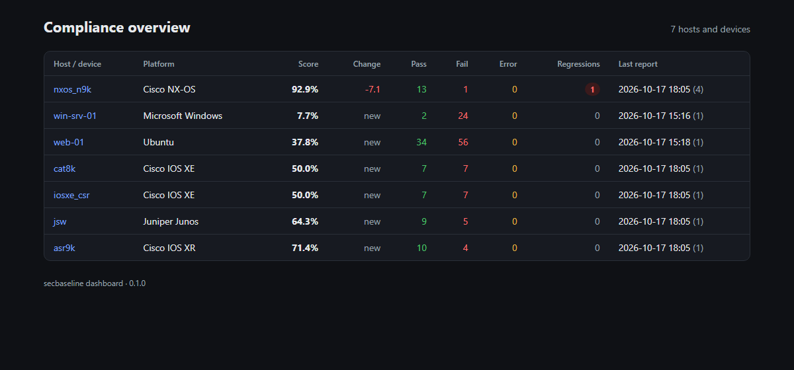
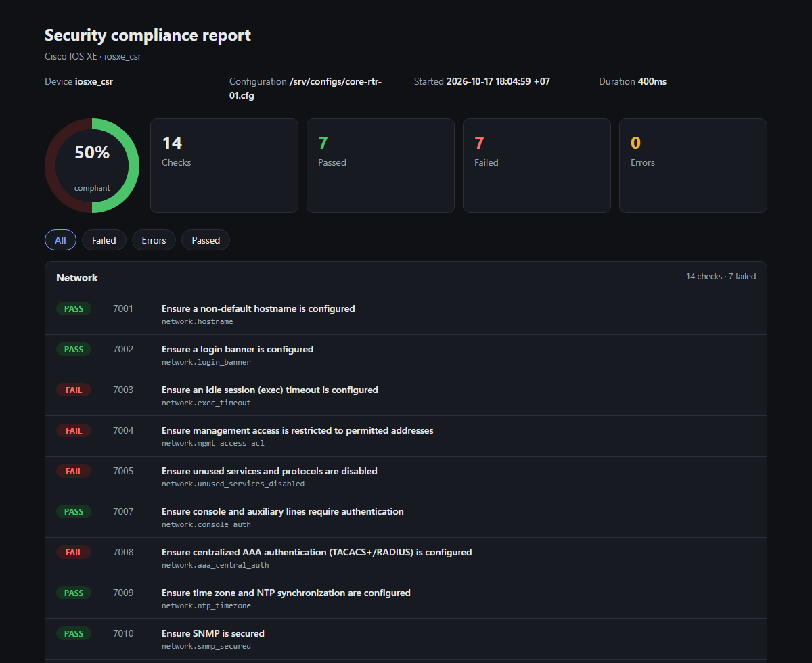
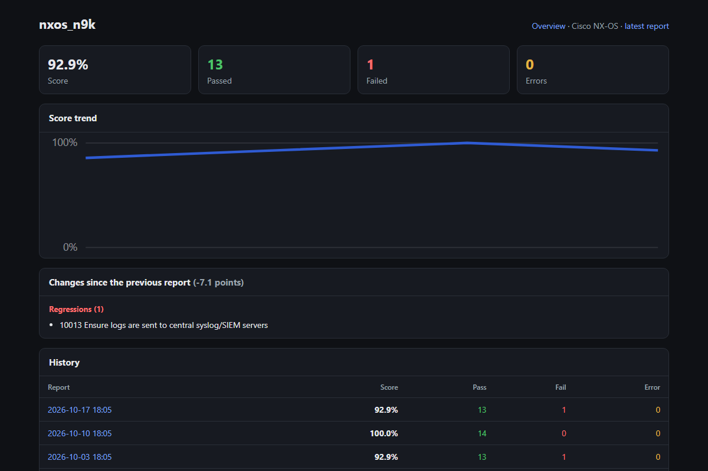
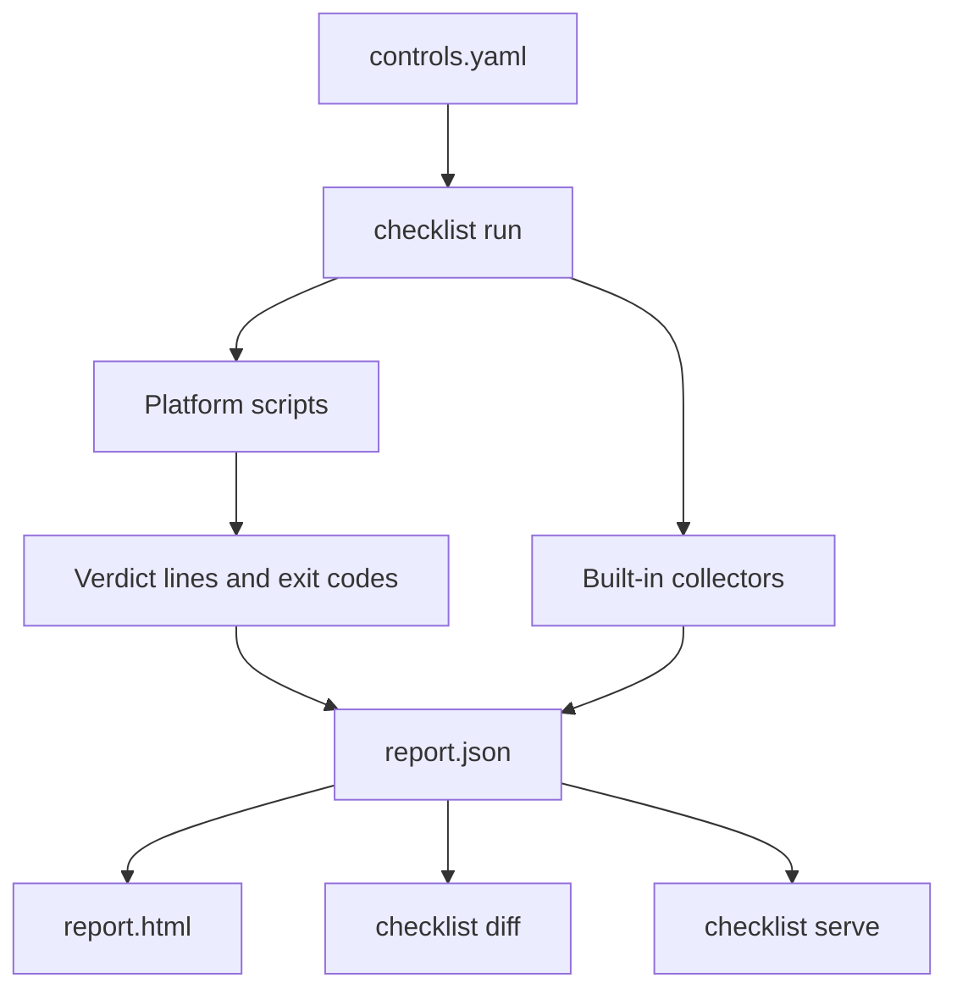

<div align="center">

# 🛡️ secbaseline

**Security hardening checks, compliance reports and drift detection for Linux, Windows and network devices.**

[](https://github.com/Khanh1916/secbaseline/actions/workflows/ci.yml)
[](https://github.com/Khanh1916/secbaseline/releases/latest)
[](checklist/go.mod)
[](controls.yaml)
[](#-coverage)
[](LICENSE)

[Features](#-features) •
[Coverage](#-coverage) •
[Quick start](#-quick-start) •
[Screenshots](#-screenshots) •
[How it works](#-how-it-works) •
[Dashboard](#-fleet-dashboard) •
[Contributing](CONTRIBUTING.md)



</div>

## ✨ Features

- **131 CIS-style controls on 12 platforms**: Ubuntu, Debian, RHEL, Rocky Linux, CentOS, SUSE,
  Oracle Linux, Windows, Cisco IOS XE / IOS XR / NX-OS and Juniper Junos.
- **One self-contained binary**: `checklist` runs the checks in parallel, writes JSON and
  standalone HTML reports, and needs no Python, database or internet access.
- **Offline network audits**: checks read a saved running configuration; no device credentials or
  connectivity needed.
- **Drift detection**: `checklist diff` shows regressions, fixes and new SSH keys, accounts,
  listening ports or firewall rules between two runs. `--exit-code` makes it usable in CI and cron.
- **Fleet dashboard**: `checklist serve` collects reports from many hosts and tracks each one's
  score, trend and latest changes.
- **One output contract**: every script prints `PASS:`/`FAIL:` and exits `0`/`1`, so the checks also
  work on their own or from other tools. `checklist lint` and CI enforce it.

## 📋 Coverage

| Platform | Directory | Controls | Check IDs |
|---|---|:---:|---|
| Ubuntu | [`ubuntu/`](ubuntu) | 90 | `1001`–`1090` |
| Debian | [`debian/`](debian) | 90 | `11001`–`11090` |
| Red Hat Enterprise Linux | [`redhat/`](redhat) | 91 | `2001`–`2091` |
| Rocky Linux | [`rocky/`](rocky) | 91 | `3001`–`3091` |
| CentOS | [`centos/`](centos) | 91 | `5001`–`5091` |
| SUSE Linux Enterprise / openSUSE | [`suse/`](suse) | 91 | `200`–`290` |
| Oracle Linux | [`oraclelinux/`](oraclelinux) | 91 | `100`–`190` |
| Windows | [`windows/`](windows) | 26 | `4001`–`4026` |
| Cisco IOS XE | [`iosxe/`](iosxe) | 14 | `7001`–`7015` |
| Juniper Junos | [`junos/`](junos) | 14 | `8001`–`8015` |
| Cisco IOS XR | [`iosxr/`](iosxr) | 14 | `9001`–`9015` |
| Cisco NX-OS | [`nxos/`](nxos) | 14 | `10001`–`10015` |

Linux controls cover mounts and filesystems, kernel hardening, SELinux, banners, time sync,
unneeded services, network parameters, firewall, SSH, logging, auditd, PAM and password policy.
Each directory's README lists its controls; [`controls.yaml`](controls.yaml) is the full catalog.

## 🚀 Quick start

Download the archive for your platform from the
[latest release](https://github.com/Khanh1916/secbaseline/releases/latest) (binary plus all check
scripts), or clone the repository, which also contains prebuilt binaries in [`checklist/`](checklist).
Run from the top-level folder, where the check scripts live.

```bash
git clone https://github.com/Khanh1916/secbaseline.git && cd secbaseline

# Linux host: run as root; the distribution is detected from /etc/os-release
sudo ./checklist/checklist run --html report.html -o report.json

# Network device: audit a saved running configuration offline
./checklist/checklist run --platform iosxe --config running-config.txt --html audit.html

# Compare two runs: regressions, fixes and inventory drift
./checklist/checklist diff yesterday.json today.json
```

On Windows, run from an elevated PowerShell:

```powershell
.\checklist\checklist.exe run --html report.html -o report.json
```

Every command and flag is documented in [`checklist/README.md`](checklist/README.md).

## 📸 Screenshots

<table>
  <tr>
    <td width="50%"></td>
    <td width="50%"></td>
  </tr>
  <tr>
    <td align="center"><b>HTML report</b>: score, filters, every check</td>
    <td align="center"><b>Host history</b>: trend and changes since the last run</td>
  </tr>
</table>

<sub>Screenshots use the sample configurations shipped in this repository.</sub>

## 🏗️ How it works



`checklist run` picks the platform's controls from `controls.yaml`, runs their scripts in parallel
with a per-check timeout, runs the inventory collectors, and writes the report.

- **Host checks** (`.sh`, `.ps1`) print optional `INFO:` lines, then one `PASS: <reason>` or
  `FAIL: <reason>` line, and exit `0` or `1`.
- **Network checks** take the configuration file as argument, print `PASS` or `FAIL`, and exit `0`
  or `1`. An empty configuration fails every check.
- A verdict that disagrees with the exit code, a missing verdict or a timeout is an `error`.
- The score is `pass / (pass + fail)`; errors are reported separately.

## 📊 Fleet dashboard

```bash
# Dashboard server
CHECKLIST_SERVER_TOKEN=change-me ./checklist/checklist serve --listen 0.0.0.0:8080 --data /var/lib/secbaseline

# Each host, e.g. from cron
sudo CHECKLIST_SERVER_TOKEN=change-me ./checklist/checklist run --upload http://dashboard:8080 -o /dev/null
```

The overview lists hosts and devices worst first. Each host page shows the score trend, the
regressions and inventory changes since its previous report, and every stored report. Reports are
stored as plain JSON files; there is no database. A token is required unless the server listens on
loopback only. Put it behind HTTPS when it is reachable over a network.

## ⚙️ Configuration

| Variable | Used by | Meaning | Default |
|---|---|---|---|
| `CHECKLIST_SIEM_SERVERS` | `7013`, `8013`, `9013`, `10013` | Accepted syslog/SIEM servers, `ip[:port]`, space- or comma-separated | per-platform list in the script |
| `CHECKLIST_TZ_OFFSET` | `7009`, `10009` | Expected UTC offset in hours | `7` |
| `CHECKLIST_TZ_NAME` | `8009`, `9009` | Expected time zone name | `Asia/Saigon` |
| `CHECKLIST_SERVER_TOKEN` | `serve`, `run --upload` | Shared dashboard token | none |

## 🧰 Inventory collectors

Built into the binary; output is sorted so runs can be diffed.

| Collector | Linux | Windows |
|---|---|---|
| SSH keys | `authorized_keys` of root and `/home/*` | `administrators_authorized_keys`, `C:\Users\*\.ssh` |
| Accounts | `/etc/passwd` | `Get-LocalUser` |
| Users and groups | `/etc/passwd`, `/etc/group`, `/etc/sudoers` | `net localgroup` members |
| Password policy | `/etc/login.defs`, PAM password config | `net accounts` |
| Patching | `uname -a` | latest hotfix (`Get-HotFix`) |
| File checksums | SHA-256 of `--files` | SHA-256 of `--files` |
| File listing | files directly in `--folders` | files directly in `--folders` |
| Listening ports | non-loopback TCP/UDP listeners | non-loopback TCP/UDP listeners |
| Firewall rules | `iptables` / `ip6tables`, all tables | `netsh advfirewall` rules |
| Log config | rsyslog configuration and status | SIEM and antivirus agent status |

## 🛠️ Development

```bash
cd checklist && go test ./... && go vet ./...
cd .. && ./checklist/checklist lint      # catalog, output contract, README tables
```

CI runs the same checks on Linux and Windows. To add or change a control, see
[CONTRIBUTING.md](CONTRIBUTING.md).

## ⚠️ Known limitations

- On RHEL, SUSE and Oracle Linux, `linux.services.mta_local_only` reads only Postfix's
  `inet_interfaces`.
- IOS XE `7007` accepts AAA only as `aaa authentication login default local`; `7008` does not
  recognize named server groups (`aaa group server`).
- Windows password and lockout checks parse `net accounts` and expect an English-language Windows.
- Oracle Linux has no inventory collector IDs.

## 👤 Author

**Cao Thanh Lam** · [@Khanh1916](https://github.com/Khanh1916)

Issues and pull requests are welcome.

## 📄 License

[MIT](LICENSE) © 2026 Cao Thanh Lam
