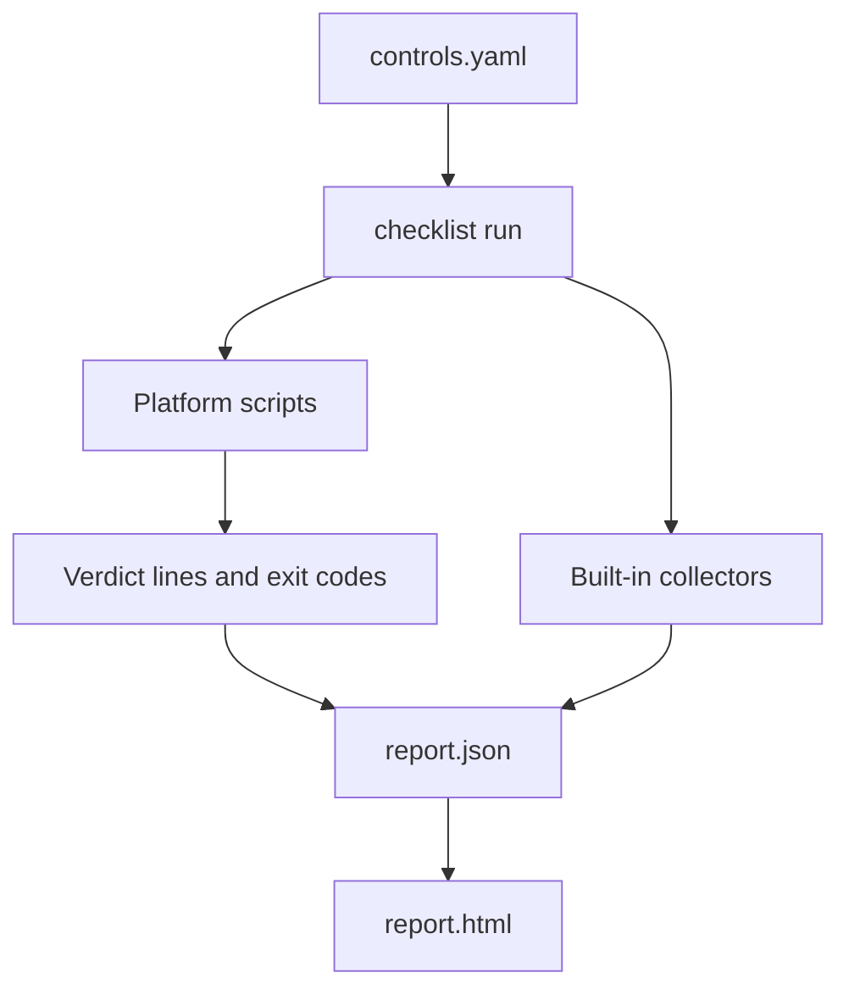

# secbaseline

Security hardening checks for Linux, Windows and network devices, plus one CLI that runs them,
writes JSON/HTML compliance reports, detects drift between runs and collects reports from many
hosts in a small dashboard.

- **131 controls on 12 platforms**: CIS-style checks for 7 Linux distributions, Windows, and Cisco
  IOS XE / IOS XR / NX-OS and Juniper Junos.
- **Offline network audits**: network checks read a saved configuration; no device access or
  credentials needed.
- **Reports, drift and dashboard**: score per host, what got worse since the last run, and new SSH
  keys, accounts, ports or firewall rules.

## Coverage

| Platform | Directory | Controls | Check IDs |
|---|---|---:|---|
| Ubuntu / Debian | [`ubuntu/`](ubuntu), [`debian/`](debian) | 90 | 1001–1090 / 11001–11090 |
| RHEL / Rocky / CentOS | [`redhat/`](redhat), [`rocky/`](rocky), [`centos/`](centos) | 91 | 2001–2091 / 3001–3091 / 5001–5091 |
| SUSE / Oracle Linux | [`suse/`](suse), [`oraclelinux/`](oraclelinux) | 91 | 200–290 / 100–190 |
| Windows | [`windows/`](windows) | 26 | 4001–4026 |
| IOS XE / Junos / IOS XR / NX-OS | [`iosxe/`](iosxe), [`junos/`](junos), [`iosxr/`](iosxr), [`nxos/`](nxos) | 14 each | 7001–7015 / 8001–8015 / 9001–9015 / 10001–10015 |

Each directory's README lists its controls. [`controls.yaml`](controls.yaml) is the full catalog.

## Quick start

Prebuilt binaries are in [`checklist/`](checklist) (`checklist` for Linux x86-64, `checklist.exe`
for Windows). Run them from the repository root.

```bash
git clone https://github.com/Khanh1916/secbaseline.git && cd secbaseline

# Linux host (as root; distribution is detected)
sudo ./checklist/checklist run --html report.html -o report.json

# Network device: audit a saved running configuration
./checklist/checklist run --platform iosxe --config running-config.txt --html audit.html

# What changed between two runs
./checklist/checklist diff yesterday.json today.json
```

On Windows, run `.\checklist\checklist.exe run --html report.html` from an elevated PowerShell.
Every command and flag is documented in [`checklist/README.md`](checklist/README.md).

## How it works



`checklist run` picks the platform's controls from `controls.yaml`, runs their scripts in parallel,
runs the inventory collectors, and writes the report. Every script follows one output contract, so
the scripts can also be used on their own:

- **Host checks** (`.sh`, `.ps1`) print optional `INFO:` lines, then one `PASS: <reason>` or
  `FAIL: <reason>` line, and exit `0` or `1`.
- **Network checks** take the config file as argument, print `PASS` or `FAIL`, and exit `0` or `1`.

A verdict that disagrees with the exit code, a missing verdict or a timeout is reported as `error`.
The score is `pass / (pass + fail)`.

## Dashboard

```bash
# Server
CHECKLIST_SERVER_TOKEN=change-me ./checklist/checklist serve --listen 0.0.0.0:8080 --data /var/lib/secbaseline

# Each host, e.g. from cron
sudo CHECKLIST_SERVER_TOKEN=change-me ./checklist/checklist run --upload http://dashboard:8080 -o /dev/null
```

The overview lists hosts and devices worst first, with score, change since the previous report and
regressions. Each host has a score trend, its latest changes and every stored report. Reports are
plain JSON files; no database. A token is required unless the dashboard listens on loopback only;
put it behind HTTPS when it is reachable over a network.

## Site configuration

Some network checks encode an organization's own policy. Override the defaults with environment
variables (each network directory's README lists them):

| Variable | Checks | Meaning |
|---|---|---|
| `CHECKLIST_SIEM_SERVERS` | `x013` | Accepted syslog/SIEM servers, `ip[:port]`, space- or comma-separated |
| `CHECKLIST_TZ_OFFSET` | `7009`, `10009` | Expected UTC offset in hours |
| `CHECKLIST_TZ_NAME` | `8009`, `9009` | Expected time zone name |

## Development

```bash
cd checklist && go test ./... && go vet ./...
./checklist/checklist lint     # from the repository root: catalog, output contract, README tables
```

CI runs the same checks on Linux and Windows. To add or change a control, see
[CONTRIBUTING.md](CONTRIBUTING.md).

## Known issues

- RHEL/SUSE/Oracle `linux.services.mta_local_only` reads only Postfix's `inet_interfaces`.
- IOS XE `7007` accepts AAA only as `aaa authentication login default local`; `7008` does not
  recognize named server groups (`aaa group server`).
- Windows password and lockout checks expect an English-language Windows (`net accounts`).
- Oracle Linux has no inventory collector IDs.
