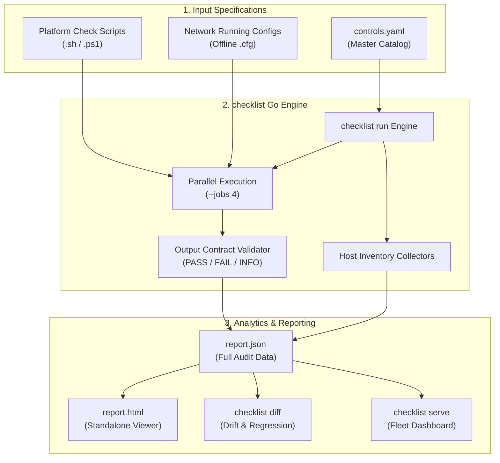

<div align="center">

# 🛡️ secbaseline

**Multi-Platform Security Hardening & Compliance Auditing Engine**

An enterprise-grade, lightweight security baseline auditing framework for Linux distributions, Windows, and enterprise network devices (Cisco & Juniper).

[](https://github.com/Khanh1916/secbaseline/actions/workflows/ci.yml)
[](checklist/go.mod)
[](#coverage-matrix)
[](controls.yaml)
[](LICENSE)
[](https://github.com/Khanh1916)
[](checklist/)
[](CONTRIBUTING.md)

<p align="center">
  <a href="#key-features">Key Features</a> •
  <a href="#coverage-matrix">Coverage Matrix</a> •
  <a href="#quick-start">Quick Start</a> •
  <a href="#how-it-works">How It Works</a> •
  <a href="#fleet-dashboard">Dashboard</a> •
  <a href="#configuration">Configuration</a> •
  <a href="#author">Author</a> •
  <a href="#license">License</a>
</p>

---

</div>

> **About this project**: `secbaseline` automates CIS-style security hardening benchmarks across 12 distinct operating systems and network platforms. Powered by a single self-contained Go CLI (`checklist`), it runs parallelized audits, gathers critical system inventories, identifies drift and regressions between scans, and renders self-contained HTML/JSON reports alongside an embedded multi-host web dashboard.

---

## 🏷️ GitHub Repository Topics / Tags

```text
security, security-hardening, cis-benchmark, compliance, devsecops, security-audit,
linux-hardening, windows-hardening, cisco-ios, juniper-junos, drift-detection,
inventory-collector, go, bash, powershell, security-tools
```

---

## ✨ Key Features

- **🛡️ 131 Standardized Controls across 12 Platforms**:
  Rigorous CIS-style controls for Ubuntu, Debian, RHEL, Rocky Linux, CentOS, SUSE, Oracle Linux, Windows Server/Desktop, and Cisco IOS XE / IOS XR / NX-OS, and Juniper Junos.
- **⚡ Single Zero-Dependency Go CLI (`checklist`)**:
  Lightweight runner that executes platform checks concurrently (`--jobs`), handles timeouts gracefully, parses standardized verdicts, and produces reports without requiring Python, Ruby, or external runtimes.
- **🌐 100% Offline Network Device Audits**:
  Audit Cisco and Juniper running configuration files offline. No live credentials, SSH sessions, or direct device access required during audit.
- **🔍 Automated Drift & Regression Detection**:
  Run `checklist diff` across consecutive scans to instantly pinpoint security regressions, newly added listening ports, altered user accounts, new SSH keys, or firewall rule modifications.
- **📊 Interactive, Self-Contained HTML & JSON Reports**:
  Zero external CDN or internet dependency. Reports include full compliance scores, categorized control statuses (`pass`, `fail`, `error`), and complete command diagnostics.
- **📈 Built-in Fleet Dashboard (`checklist serve`)**:
  Lightweight embedded HTTP server with token-based authentication to aggregate audit reports across multi-host environments with historical score trend lines.
- **🧰 10 Built-in Inventory Collectors**:
  Collect deterministic baseline inventories for SSH authorized keys, local users/groups, PAM and password policies, patch status, listening network ports, firewall tables, and file hashes.

---

## 📋 Coverage Matrix

| Platform | Category | Directory | Controls | Check IDs |
|---|---|---|:---:|---|
| **Ubuntu** | Linux | [`ubuntu/`](ubuntu) | 90 | `1001` – `1090` |
| **Debian** | Linux | [`debian/`](debian) | 90 | `11001` – `11090` |
| **Red Hat Enterprise Linux (RHEL)** | Linux | [`redhat/`](redhat) | 91 | `2001` – `2091` |
| **Rocky Linux** | Linux | [`rocky/`](rocky) | 91 | `3001` – `3091` |
| **CentOS** | Linux | [`centos/`](centos) | 91 | `5001` – `5091` |
| **SUSE Linux Enterprise** | Linux | [`suse/`](suse) | 91 | `200` – `290` |
| **Oracle Linux** | Linux | [`oraclelinux/`](oraclelinux) | 91 | `100` – `190` |
| **Windows Server / Desktop** | Windows | [`windows/`](windows) | 26 | `4001` – `4026` |
| **Cisco IOS XE** | Network | [`iosxe/`](iosxe) | 14 | `7001` – `7015` |
| **Juniper Junos** | Network | [`junos/`](junos) | 14 | `8001` – `8015` |
| **Cisco IOS XR** | Network | [`iosxr/`](iosxr) | 14 | `9001` – `9015` |
| **Cisco NX-OS** | Network | [`nxos/`](nxos) | 14 | `10001` – `10015` |

> Every platform directory contains a detailed `README.md` listing each control check and corresponding remediation rationale. [`controls.yaml`](controls.yaml) serves as the authoritative catalog.

---

## 🚀 Quick Start

Pre-built binaries for 64-bit Linux (`checklist`) and Windows (`checklist.exe`) are included in [`checklist/`](checklist).

### 1. Clone Repository

```bash
git clone https://github.com/Khanh1916/secbaseline.git
cd secbaseline
```

### 2. Audit a Linux Host

Run with root privileges (the local Linux distribution is detected automatically via `/etc/os-release`):

```bash
sudo ./checklist/checklist run --html report.html -o report.json
```

### 3. Audit a Windows Host

From an elevated PowerShell session (Run as Administrator):

```powershell
.\checklist\checklist.exe run --html report.html -o report.json
```

### 4. Audit Network Device Configurations (Offline)

Audit a saved running configuration without needing device credentials or connectivity:

```bash
# Cisco IOS XE
./checklist/checklist run --platform iosxe --config running-config.txt --html iosxe-audit.html

# Juniper Junos
./checklist/checklist run --platform junos --config junos.cfg --html junos-audit.html

# Cisco IOS XR
./checklist/checklist run --platform iosxr --config asr9k.cfg -o iosxr-audit.json

# Cisco NX-OS
./checklist/checklist run --platform nxos --config n9k.cfg --html nxos-audit.html
```

### 5. Detect Drift & Regressions Between Runs

Compare two historical JSON reports to detect regressions, fixed issues, and changes in inventory (listening ports, SSH keys, user accounts):

```bash
./checklist/checklist diff yesterday.json today.json
```

Add `--exit-code` to integrate into automated CI/CD pipelines (returns exit code `2` if regressions are detected).

---

## 🏗️ How It Works



### Execution Engine & Output Contract

`checklist run` dynamically discovers controls matching the target platform from [`controls.yaml`](controls.yaml), executes checks in parallel, executes inventory collectors, and compiles results:

- **Host Checks** (`.sh`, `.ps1`): Output optional `INFO: <detail>` lines, followed by exactly one verdict `PASS: <reason>` or `FAIL: <reason>`, terminating with exit code `0` or `1`.
- **Network Checks**: Audit the configuration file passed as argument, print `PASS` or `FAIL`, and exit `0` or `1`.
- **Integrity**: Any discrepancy between stdout verdict and exit status, or a script timeout (default `2m`), is classified as an `error`.
- **Compliance Score**: Calculated as:
  $$\text{Score} = \frac{\text{PASS}}{\text{PASS} + \text{FAIL}} \times 100\%$$

---

## 📊 Fleet Dashboard

Collect reports across servers and switches in a centralized, lightweight dashboard:

```bash
# 1. Start the central dashboard server
CHECKLIST_SERVER_TOKEN="your-secure-token" ./checklist/checklist serve --listen 0.0.0.0:8080 --data /var/lib/secbaseline

# 2. Upload reports from client machines (e.g., via cron)
sudo CHECKLIST_SERVER_TOKEN="your-secure-token" ./checklist/checklist run --upload http://dashboard.internal:8080 -o /dev/null
```

- **Overview**: Lists hosts sorted by compliance health (worst first), delta scores, and regressions.
- **Host Detail**: Historical score trends, latest system changes, and access to all historical HTML audits.
- **No Database Required**: Reports are persisted as clean JSON files with atomic writes.

---

## ⚙️ Configuration & Policy Tuning

Network checks allow customizing organizational baseline policies via environment variables:

| Environment Variable | Affected Checks | Description | Default |
|---|---|---|---|
| `CHECKLIST_SIEM_SERVERS` | `7013`, `8013`, `9013`, `10013` | Approved Syslog/SIEM server IPs/ports (space/comma separated) | Organization SIEM list |
| `CHECKLIST_TZ_OFFSET` | `7009`, `10009` | Expected UTC time zone offset in hours | `7` (Asia/Saigon) |
| `CHECKLIST_TZ_NAME` | `8009`, `9009` | Expected time zone identifier string | `Asia/Saigon` |
| `CHECKLIST_SERVER_TOKEN` | Dashboard server & upload | Bearer authentication secret for dashboard API & UI | None (required for non-loopback) |

---

## 🧰 Inventory Collectors

In addition to compliance checks, the Go binary includes 10 built-in inventory collectors producing deterministic, diff-friendly output:

| Collector | Linux Inspection Target | Windows Inspection Target |
|---|---|---|
| **SSH Keys** | `/root/.ssh/authorized_keys`, `/home/*/.ssh/authorized_keys` | `administrators_authorized_keys`, user `.ssh` |
| **Local Accounts** | `/etc/passwd` | `Get-LocalUser` |
| **Users & Groups** | `/etc/passwd`, `/etc/group`, `/etc/sudoers` | `net localgroup` membership |
| **Password Policy** | `/etc/login.defs`, PAM faillock / tally2 | `net accounts` |
| **Kernel & Patches** | `uname -a` | `Get-HotFix` (latest hotfix) |
| **File Checksums** | SHA-256 computation over `--files` | SHA-256 computation over `--files` |
| **Directory Files** | Recursive directory listing over `--folders` | Recursive directory listing over `--folders` |
| **Listening Ports** | Non-loopback TCP/UDP listeners | Non-loopback TCP/UDP listeners |
| **Firewall Rules** | `iptables` / `ip6tables` across all tables | `netsh advfirewall firewall show rule` |
| **Logging Services** | `rsyslog` daemon & configuration status | Antivirus & SIEM agent service status |

---

## 🛠️ Development & Quality Assurance

### Building from Source

Requires Go 1.24 or later:

```bash
cd checklist

# Build binary for current platform
go build -o checklist .

# Cross-compile for Linux and Windows
GOOS=linux   GOARCH=amd64 go build -trimpath -o checklist .
GOOS=windows GOARCH=amd64 go build -trimpath -o checklist.exe .
```

### Running Tests & Linting

```bash
# Run unit tests and internal lint suite
cd checklist && go test ./... && go vet ./...

# Validate catalog, output contracts, and documentation tables
cd .. && ./checklist/checklist lint

# Regenerate platform README control tables
./checklist/checklist docs
```

For guidelines on adding new controls or platforms, see [CONTRIBUTING.md](CONTRIBUTING.md).

---

## 👤 Author

**Cao Thanh Lam**

- GitHub: [@Khanh1916](https://github.com/Khanh1916)
- Project: [secbaseline](https://github.com/Khanh1916/secbaseline)

Contributions, feature requests, and bug reports are warmly welcome!

---

## 📄 License

This project is licensed under the **MIT License** — see the [LICENSE](LICENSE) file for complete details.

Copyright (c) 2026 **Cao Thanh Lam**. All rights reserved.
