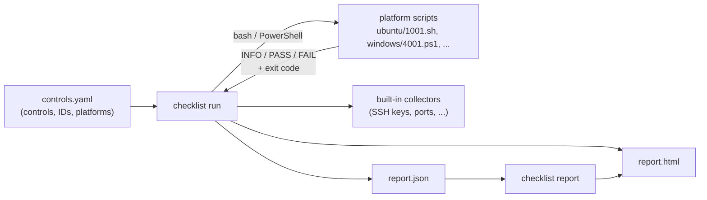

# Technical Cybersecurity Checklist

Security hardening checks for Linux servers, Windows hosts and network devices, with one command-line
tool that runs them and produces machine-readable (JSON) and human-readable (HTML) compliance reports.

- **131 controls on 12 platforms**: 91 CIS-style Linux controls across 7 distributions, 26 Windows
  controls, and 14 controls for each of 4 network operating systems.
- **Offline network audits**: network checks read a saved configuration file. They never connect
  to the device and need no credentials.
- **One binary**: `checklist run` executes the checks, `checklist report` renders HTML, and
  `checklist lint` enforces the repository's conventions.
- **Inventory for baselining**: built-in collectors record SSH keys, accounts, groups, listening
  ports, firewall rules and file hashes as sorted text that can be diffed between runs.
- **One output contract**: every script reports the same way, which `checklist lint` and the Go
  tests enforce.

## Coverage

| Platform | Kind | Directory | Controls | Check IDs | Collector IDs |
|---|---|---|---:|---|---|
| Ubuntu | Linux | [`ubuntu/`](ubuntu) | 90 | 1001–1090 | 1091–1100 |
| Debian | Linux | [`debian/`](debian) | 90 | 11001–11090 | 11091–11100 |
| Red Hat Enterprise Linux | Linux | [`redhat/`](redhat) | 91 | 2001–2091 | 2092–2101 |
| Rocky Linux | Linux | [`rocky/`](rocky) | 91 | 3001–3091 | 3092–3101 |
| CentOS | Linux | [`centos/`](centos) | 91 | 5001–5091 | 5092–5101 |
| SUSE / openSUSE | Linux | [`suse/`](suse) | 91 | 200–290 | 291–300 |
| Oracle Linux | Linux | [`oraclelinux/`](oraclelinux) | 91 | 100–190 | none |
| Microsoft Windows | Windows | [`windows/`](windows) | 26 | 4001–4026 | 4027–4036 |
| Cisco IOS XE | Network | [`iosxe/`](iosxe) | 14 | 7001–7015 | none |
| Juniper Junos | Network | [`junos/`](junos) | 14 | 8001–8015 | none |
| Cisco IOS XR | Network | [`iosxr/`](iosxr) | 14 | 9001–9015 | none |
| Cisco NX-OS | Network | [`nxos/`](nxos) | 14 | 10001–10015 | none |

Linux controls cover filesystem and mount options, kernel hardening, SELinux, banners, time
synchronization, unnecessary services and clients, network parameters, TCP Wrappers, host firewall,
SSH, logging, auditd, PAM and password policy. Windows controls cover password and lockout policy,
user rights, logon banner, Guest account, advanced audit policy, antivirus and backup. Network
controls cover hostname, banner, session timeout, management ACLs, unused services, console
authentication, AAA, NTP, SNMP, SSH, password encryption, central logging, login attempt limits and
configuration backup. Each platform directory's README lists its controls.

## Quick start

The repository ships prebuilt binaries in [`checklist/`](checklist): `checklist` (Linux x86-64)
and `checklist.exe` (Windows x86-64). Run them from the repository root.

**Linux host.** Run as root; the distribution is detected automatically.

```bash
git clone https://github.com/Khanh1916/technical-cybersec-checklist.git
cd technical-cybersec-checklist
sudo ./checklist/checklist run --html report.html -o report.json
```

**Windows host.** Run from an elevated PowerShell prompt.

```powershell
.\checklist\checklist.exe run --html report.html -o report.json
```

**Network device.** Audit a saved running configuration from any machine with `bash`.

```bash
./checklist/checklist run --platform iosxe --config running-config.txt --html audit.html
```

**Render a saved report** (for example, JSON collected from many hosts):

```bash
./checklist/checklist report web01.json -o web01.html
```

The run prints a one-line summary to stderr, such as
`iosxe: 14 checks, 8 passed, 6 failed, 0 errors (score 57.1%)`. See
[`checklist/README.md`](checklist/README.md) for every flag.

## How it works



1. [`controls.yaml`](controls.yaml) lists every control with a stable key, a title and the
   script ID on each platform.
2. `checklist run` selects the controls for the platform, runs their scripts in parallel with a
   per-check timeout, and classifies each result from its output and exit code.
3. Unless `--no-collectors` is given, it runs the inventory collectors compiled into the binary.
4. It writes a JSON report and, with `--html`, a self-contained HTML page with a score, per-section
   results and status filters.

## Output contract

All checks follow one contract, so any tool can consume them directly, with or without the runner.

**Host checks** (Linux `.sh`, Windows `.ps1`) take no arguments and print zero or more detail lines
followed by exactly one verdict line:

```text
INFO: /etc/pam.d/system-auth: pam_faillock.so deny=5 (argument)
INFO: /etc/pam.d/password-auth: pam_faillock.so deny=5 (argument)
PASS: Account lockout deny is between 1 and 5 on every pam_faillock/pam_tally2 auth line
```

The script exits `0` after a `PASS:` line and `1` after a `FAIL:` line. No other exit codes are
used. Output is English and ASCII.

**Network checks** take the configuration file as their only argument and print exactly `PASS` or
`FAIL`, exiting `0` or `1` to match.

The runner treats any disagreement between the verdict line and the exit code, a missing verdict,
or a timeout as an `error` and keeps the raw output for diagnosis.

## Reports

A JSON report contains the platform, the machine the run happened on, the audited configuration
(network runs), a summary and one entry per check and collector:

```json
{
  "schema_version": 1,
  "tool": { "name": "checklist", "version": "1.0.0" },
  "platform": { "key": "ubuntu", "name": "Ubuntu", "kind": "linux" },
  "host": { "hostname": "web01", "os": "linux", "platform": "ubuntu", "platform_version": "24.04", "arch": "amd64" },
  "started_at": "2026-10-17T08:20:02Z",
  "summary": { "total": 90, "pass": 71, "fail": 18, "error": 1, "score": 79.8 },
  "checks": [
    {
      "key": "linux.filesystem.var_tmp_partition",
      "id": "1013",
      "title": "Ensure /var/tmp is a separate partition or bound to /tmp",
      "section": "filesystem",
      "status": "fail",
      "message": "/var/tmp is not a symlink to /tmp",
      "details": ["drwxrwxrwt 2 root root 4096 Oct 17 08:00 /var/tmp"],
      "exit_code": 1,
      "duration_ms": 4
    }
  ],
  "collectors": [
    { "key": "collect.listening_ports", "id": "1098", "title": "Non-loopback listening TCP/UDP ports", "status": "ok", "output": "0.0.0.0:22/TCP" }
  ]
}
```

- Check `status` is `pass`, `fail` or `error`. Collector `status` is `ok`, `error` or `skipped`.
- `score` is `pass / (pass + fail)` as a percentage. Errors are excluded, so look at them separately.
- Network reports add a `target` object with the configuration path, its SHA-256 and the device
  hostname parsed from it.
- `schema_version` changes only when the layout changes incompatibly.

## The catalog: `controls.yaml`

```yaml
platforms:
  ubuntu: {kind: linux, name: Ubuntu, detect: [ubuntu]}
controls:
  - key: linux.ssh.ssh_root_login_disabled
    title: Ensure SSH root login is disabled
    ids: {ubuntu: 1075, debian: 11075, redhat: 2076, rocky: 3076, centos: 5076, suse: 275, oraclelinux: 175}
collectors:
  - key: collect.listening_ports
    title: Non-loopback listening TCP/UDP ports
    ids: {ubuntu: 1098, ..., windows: 4034}
```

- **Keys** are `<family>.<section>.<name>` (`network.<name>` for network controls) and never change,
  so reports stay comparable across script renumbering.
- **IDs** are the script file names: `ubuntu: 1075` is `ubuntu/1075.sh`. They are listed explicitly
  because they do not align by index across families. Ubuntu and Debian have no separate NIS client
  control, so from the rsh control onward their IDs are one lower than the RHEL-family index.
- **Platforms** set how scripts run (`linux` and `network` with bash, `windows` with PowerShell)
  and which `/etc/os-release` IDs select them.

## Repository layout

```text
.
├── controls.yaml        catalog of every control and collector
├── checklist/           Go CLI: runner, reports, lint, collectors (see checklist/README.md)
├── ubuntu/ debian/      Debian-family checks
├── redhat/ rocky/ centos/ oraclelinux/ suse/
│                        RHEL-family and SUSE checks
├── windows/             PowerShell checks
└── iosxe/ junos/ iosxr/ nxos/
                         network configuration checks, sample configs and shell runners
```

## Development

Requirements: Go 1.24+, `bash`. On Windows, use Git Bash for the shell scripts.

```bash
cd checklist
go test ./...                  # unit tests, plus lint of the real catalog and scripts
go vet ./...
go build -o checklist .        # then from the repository root:
./checklist/checklist lint     # catalog, output contract, README tables
```

### Adding or changing a control

1. Write the script in each platform directory it applies to, following the
   [output contract](#output-contract). Start from the closest existing check; `redhat/` is the
   reference for the RHEL family and `ubuntu/` for Debian-based systems.
2. Add an entry to `controls.yaml` with a new key, a title starting with "Ensure", and the script
   ID for every platform.
3. Run `./checklist/checklist docs` to refresh the platform READMEs, then
   `./checklist/checklist lint`.
4. Run the check on a real or virtual host. Network checks can be run against the sample
   configurations in each network directory.

### Conventions

- Shell scripts use LF line endings and start with `#!/bin/bash` on line 1. `.gitattributes`
  enforces the line endings.
- Scripts and messages are in English and plain ASCII.
- Exit codes are only `0` and `1`.
- A check's script ID is its identity in downstream systems. Don't renumber files; add new IDs instead.

## Known issues

These come from reviewing the check logic. They are not fixed yet.

- `linux.services.mta_local_only` on the RHEL family, SUSE and Oracle Linux reads only Postfix's
  `inet_interfaces`, so it fails when Postfix is not installed and ignores other MTAs. Ubuntu and
  Debian check the listening sockets instead.
- Several network checks pass on an empty configuration: IOS XE `7003`, `7007` and `7008`; Junos
  `8004`, `8005` and `8010`; IOS XR `9004` and `9005`; NX-OS `10007` and `10011`. Some are
  deliberate ("not applicable" when nothing is configured); others, such as `7008` (centralized AAA),
  likely hide a gap.
- Network checks encode one organization's time zone (UTC+7) and SIEM server list. See each network
  directory's README.
- Windows password and lockout checks parse `net accounts` and expect an English-language Windows.
- Oracle Linux has no inventory collector IDs.
